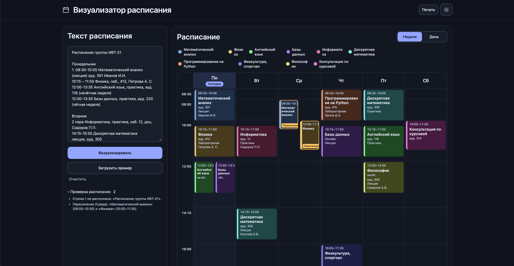

# Визуализатор расписания

Веб-приложение на Python, которое распознаёт скопированный текст расписания и строит из него интерактивную сетку занятий с цветовой маркировкой предметов.

Учебный проект (задание продвинутого уровня №1). Работает на стандартной библиотеке Python, внешние зависимости не нужны.



## Возможности

- **Распознавание произвольного текста.** Расписание можно вставить в том виде, в каком оно скопировано с сайта вуза, из мессенджера или таблицы.
- **Интерактивная сетка.** Дни недели по горизонтали, время по вертикали, занятия в виде цветных карточек.
- **Цвет по предмету.** Каждый предмет всегда получает один и тот же цвет, близкие оттенки автоматически разводятся.
- **Поиск пересечений.** Накладывающиеся занятия подсвечиваются пунктирной рамкой и попадают в список замечаний.
- **Чётные и нечётные недели.** Переключатель «Все / Нечётная / Чётная». Пары на разных неделях в одно время показываются рядом и пересечением не считаются.
- **Фильтр по предметам.** Нажатие на предмет в легенде скрывает или показывает его в сетке.
- **Карточка занятия.** По клику открываются время, тип, аудитория, преподаватель и заметки.
- **Дополнительно.** Красная линия текущего времени, подсветка сегодняшнего дня, печать, светлая и тёмная темы, автосохранение введённого текста в браузере.

## Требования

- Python 3.10 или новее
- Любой современный браузер

## Запуск

1. Склонируйте репозиторий и перейдите в его папку:

   ```
   git clone https://github.com/<ваш-логин>/<название-репозитория>.git
   cd <название-репозитория>
   ```

2. Запустите сервер:

   ```
   python -m schedule_viz serve --open
   ```

   Откроется браузер с адресом http://127.0.0.1:8000. Если браузер не открылся, запустите команду без `--open` и перейдите по адресу вручную. Остановить сервер можно сочетанием `Ctrl+C`.

3. Нажмите «Загрузить пример» или вставьте своё расписание в левое поле.

Другие параметры запуска:

| Параметр | По умолчанию | Описание |
|---|---|---|
| `--host` | `127.0.0.1` | Адрес, на котором слушает сервер |
| `--port` | `8000` | Порт |
| `--open` | выключен | Открыть браузер после старта |

Только разбор текста без веб-интерфейса (результат выводится в JSON):

```
python -m schedule_viz parse schedule_viz/static/sample.txt
```

## Какой текст понимает парсер

Форматы можно смешивать в одном расписании.

| Что | Примеры |
|---|---|
| День недели | `Понедельник`, `Пн`, `Вт:`, `Среда (26.11)`, `Mon` |
| Время | `09:00-10:30`, `10:15 – 11:50`, `8.30-10.05`, `с 9:00 до 10:30` |
| Номер пары | `2 пара`, `пара 3` (времена по умолчанию: 1-я пара 08:30–10:05, 2-я 10:15–11:50 и т. д.) |
| Тип занятия | лекция, семинар, практика, лаб., экзамен, зачёт, консультация |
| Аудитория | `ауд. 301`, `каб. 12`, `онлайн`, а также просто `412` в конце строки |
| Преподаватель | `Иванов И.И.`, `доц. Иванов И.И.`, `И.И. Иванов`, `Иванов Иван Иванович` |
| Неделя | `(нечётная неделя)`, `по чётным`, `(чёт.)` |

Занятие может занимать несколько строк: строки без времени дописываются к предыдущему занятию.

```
Вторник
14:15-15:50 Дискретная математика
  лекция, ауд. 305
  Козлова Е.В.
```

Всё, что не удалось распознать, не приводит к ошибке, а попадает в раскрывающийся список «Замечания» под полем ввода.

## Как это работает

1. Браузер отправляет текст на `POST /api/parse`.
2. Парсер (`parser.py`) идёт по строкам. Заголовок дня задаёт текущий день, строка со временем или номером пары открывает новое занятие, остальные строки дописываются к нему.
3. Из текста занятия по очереди вырезаются чётность недели, тип, аудитория и преподаватель. Что осталось, то название предмета.
4. Каждому предмету назначается цвет, затем ищутся пересечения.
5. Сервер возвращает JSON, а `app.js` рисует сетку и раскладывает пересекающиеся занятия по «дорожкам» бок о бок.

### API

`POST /api/parse`

```json
{ "text": "Пн 09:00-10:30 Алгебра, лекция, ауд. 205" }
```

Ответ:

```json
{
  "lessons": [
    {
      "day": 0, "dayName": "Понедельник",
      "start": 540, "end": 630, "startText": "09:00", "endText": "10:30",
      "subject": "Алгебра", "kind": "Лекция", "room": "205",
      "teacher": null, "parity": "all", "notes": null,
      "hue": 123, "conflict": false
    }
  ],
  "subjects": [{ "name": "Алгебра", "hue": 123 }],
  "warnings": []
}
```

Время (`start`, `end`) задано в минутах от полуночи, `day` считается от понедельника (0). Остальные маршруты: `GET /` (страница), `GET /static/*` (css, js, пример), `GET /healthz` (проверка работы).

### Использование как библиотеки

```python
from schedule_viz import parse_schedule

result = parse_schedule("Пн 09:00-10:30 Алгебра, лекция, ауд. 205")
for lesson in result.lessons:
    print(lesson.subject, lesson.day, lesson.start, lesson.end)

# свои времена пар
result = parse_schedule(text, pair_times={1: ("09:00", "10:30"), 2: ("10:40", "12:10")})
```

## Структура проекта

```
schedule_visualizer/
├── schedule_viz/
│   ├── __init__.py
│   ├── __main__.py      командная строка: serve и parse
│   ├── models.py        Lesson, Parity, ParseResult (dataclasses)
│   ├── parser.py        parse_schedule(text) -> ParseResult
│   ├── colors.py        детерминированные цвета предметов
│   ├── server.py        HTTP-сервер на http.server
│   └── static/
│       ├── index.html
│       ├── style.css
│       ├── app.js
│       └── sample.txt   пример расписания
├── tests/
│   └── test_parser.py   тесты парсера, цветов и HTTP API
├── docs/
│   └── screenshot.png
├── pyproject.toml
└── README.md
```

## Тесты

```
python -m unittest discover -s tests -v
```

Тесты покрывают разные форматы записи, чётность недели, ложные срабатывания («Нечеткая логика», «Практика по программированию»), поиск пересечений, устойчивость к некорректному вводу, стабильность цветов и HTTP API (включая неверный JSON и попытку выхода за пределы папки со статикой).

## Безопасность и надёжность

- Парсер не бросает исключений из-за формата текста.
- Размер запроса ограничен 256 КБ, тело запроса проверяется как JSON.
- Статические файлы отдаются по белому списку, выход за пределы папки невозможен.
- Заголовки `Content-Security-Policy`, `X-Content-Type-Options`, `X-Frame-Options`.
- На странице пользовательский текст выводится через `textContent`, поэтому внедрить HTML нельзя.

## Ограничения

- Сервер рассчитан на локальное использование, а не на публичный хостинг.
- Запись, где тип занятия стоит в начале без запятой («Лекция Математика»), распознаётся как название предмета.
- Парсер не определяет, какая неделя сейчас чётная: фильтр работает по пометкам в тексте.
- Времена пар по умолчанию типовые, для своего вуза их можно задать параметром `pair_times`.

## Идеи для развития

- Экспорт в календарь (`.ics`)
- Определение текущей чётности недели по дате начала семестра
- Загрузка расписания из файла (`.docx`, `.xlsx`, `.csv`)
- Сохранение расписаний в базе данных и несколько групп одновременно
